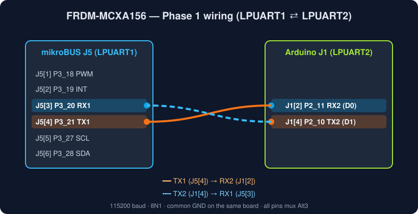
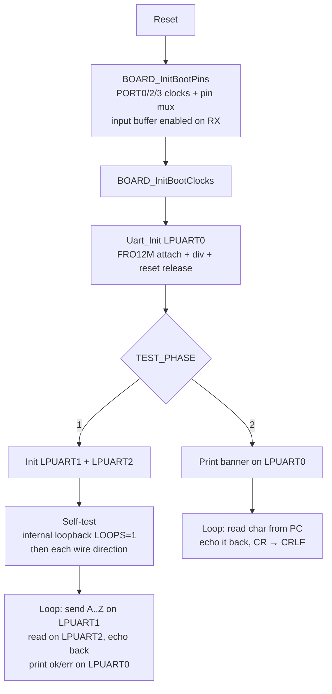
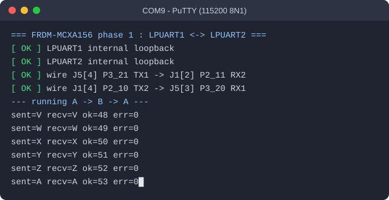

# FRDM-MCXA156 — LPUART test (UART ⇄ UART and UART ⇄ PC)

Bare-metal MCUXpresso project for the NXP **FRDM-MCXA156** (Arm Cortex-M33 MCXA156) that:

1. **Phase 1** exchanges characters between two on-chip UARTs, **LPUART1** on the mikroBUS header and **LPUART2** on the Arduino header, with a self-test and live counters printed to the PC.
2. **Phase 2** echoes characters between **LPUART0** and a PC terminal (PuTTY) through the on-board MCU-Link virtual COM port.

<p align="center">
  <br>
  <sub>FRDM-MCXA156 board. Image from the <a href="https://docs.zephyrproject.org/latest/boards/nxp/frdm_mcxa156/doc/index.html">Zephyr Project board documentation</a> (Apache-2.0).</sub>
</p>

---

## Hardware

| Item | Detail |
|---|---|
| Board | NXP FRDM-MCXA156 (MCXA156VLL, Cortex-M33, 1 MB flash) |
| Debug / VCOM | On-board MCU-Link (CMSIS-DAP) over USB, shows up as a COM port (COM9 here) |
| Extra parts | 2 jumper wires (phase 1 only) |

### Pin mapping

The pin assignments come from the board labels in the MCUXpresso SDK for FRDM-MCXA156. The Alt3 mux for P3_20/P3_21 matches NXP's own `lpuart/polling` example.

| UART | Purpose | RX | TX | Mux |
|---|---|---|---|---|
| LPUART0 | MCU-Link VCOM → PC | P0_2 | P0_3 | Alt2 |
| LPUART1 | mikroBUS **J5** | P3_20 → **J5[3]** | P3_21 → **J5[4]** | Alt3 |
| LPUART2 | Arduino **J1** | P2_11 → **J1[2]** (D0) | P2_10 → **J1[4]** (D1) | Alt3 |

All UARTs run at **115200 baud, 8N1**, clocked from **FRO12M / 1 = 12 MHz**.

### Phase 1 wiring

Two jumper wires, **crossed** (TX goes to RX):

<p align="center"></p>

- `J5[4]` (TX1) → `J1[2]` (RX2)
- `J1[4]` (TX2) → `J5[3]` (RX1)

Phase 2 needs no wiring, only the USB cable.

---

## How it works



### MCXA pitfalls this project handles

- **`LPUART_Init()` is not enough on MCXA.** It only opens the bus clock gate. The functional clock still has to be selected (`CLOCK_AttachClk(kFRO12M_to_LPUARTx)`), the divider set (`CLOCK_SetClockDiv`), and the block released from reset (`RESET_ReleasePeripheralReset`). See `Uart_ClockAndReset()` in [`source/main.c`](source/main.c).
- **Input buffer enable (IBE).** MCXA pins have a separate input buffer bit in `PCR`. Without it, an RX pin never sees the line. [`board/pin_mux.c`](board/pin_mux.c) enables it on every UART pin.
- **Use the right header pins.** Several MCXA156 pins can carry LPUART1/2. Only the ones in the table above are routed to the mikroBUS and Arduino UART positions.
- **Overruns stop reception.** On LPUART, a set overrun flag blocks new data, so the code flushes RX and clears the error flags before each transfer.

### Self-test (phase 1)

At boot, the firmware first tests each UART in **internal loopback** (`CTRL[LOOPS]=1`, `RSRC=0`), which needs no wiring. It then tests each wire direction separately. This splits a failure into two cases:

| Result | Meaning |
|---|---|
| Loopback FAIL | Clock or peripheral problem (firmware) |
| Loopback OK, wire FAIL | Wiring or pin-header problem |
| All OK | Counters run with `err=0` |

---

## Results

Phase 1 running on the real board. The counter lines were captured from COM9, and the self-test header shows what the firmware prints at boot:

<p align="center"></p>

Every character A→Z makes the full LPUART1 → LPUART2 → LPUART1 round trip with `err=0`.

---

## Build and run

### Requirements
- [MCUXpresso IDE](https://www.nxp.com/design/design-center/software/development-software/mcuxpresso-software-and-tools-/mcuxpresso-integrated-development-environment-ide:MCUXpresso-IDE) 25.6 or later
- FRDM-MCXA156 SDK installed in the IDE ([MCUXpresso SDK Builder](https://mcuxpresso.nxp.com/))
- A serial terminal ([PuTTY](https://www.putty.org/), Tera Term, …)

### Steps
1. Clone the repo, then in MCUXpresso IDE use **File → Import → Existing Projects into Workspace** and select the cloned folder.
2. Choose the test in [`source/main.c`](source/main.c):
   ```c
   #define TEST_PHASE   1   /* 1 = UART<->UART, 2 = UART<->PC */
   ```
3. Build (hammer icon), then **Debug** with the LinkServer probe. The launch config `frdmmcxa156_uart_test LinkServer Debug.launch` is included. If it doesn't pick your board, select your MCU-Link probe when prompted.
4. Open PuTTY: **Serial**, the MCU-Link COM port, **115200**, 8 data bits, no parity, 1 stop bit, **flow control None**.
5. Press **RESET** on the board to see the boot banner and the self-test.

#### Command line (optional)
```powershell
# Headless build
mcuxpressoidec.exe -nosplash -application org.eclipse.cdt.managedbuilder.core.headlessbuild `
  -data <workspace> -import <path>\frdmmcxa156_uart_test -build frdmmcxa156_uart_test/Debug
```

---

## Project layout

```
source/main.c          application (phase 1 / phase 2)
board/pin_mux.c/.h     pin routing (LPUART0/1/2)
board/clock_config.*   system clocks (SDK generated)
frdmmcxa156_uart_test.mex   MCUXpresso Config Tools settings (matches pin_mux.c)
drivers/ device/ CMSIS/ startup/ utilities/ component/   NXP MCUXpresso SDK files
docs/                  images used in this README
```

---

## References

- [FRDM-MCXA156 board page — NXP](https://www.nxp.com/design/design-center/development-boards-and-designs/general-purpose-mcus/frdm-development-board-for-mcx-a144-5-6-a154-5-6-mcus:FRDM-MCXA156)
- [UM12121 — FRDM-MCXA156 Board User Manual (PDF)](https://www.nxp.com/docs/en/user-manual/UM12121.pdf)
- [Getting Started with FRDM-MCXA156 — NXP](https://www.nxp.com/document/guide/getting-started-with-frdm-mcxa156:GS-FRDM-MCXA156)
- [MCXA156 Data Sheet (PDF)](https://www.nxp.com/docs/en/data-sheet/MCXAP100M96FS6.pdf)
- [MCXA156 Reference Manual (NXP download, LPUART and PORT chapters)](https://www.nxp.com/webapp/Download?colCode=MCXAP100M96FS6RM)
- [FRDM-MCXA156 schematics (NXP download)](https://www.nxp.com/webapp/Download?colCode=SPF-90841)
- [MCXA156VLL errata (PDF)](https://www.nxp.com.cn/docs/en/errata/MCXA156VLL_0P29K.pdf)
- [MCUXpresso SDK documentation — FRDM-MCXA156](https://docs.mcuxpresso.nxp.com/mcuxsdk/latest/html/boards/MCX/frdmmcxa156/index.html)
- [Zephyr board documentation — FRDM-MCXA156](https://docs.zephyrproject.org/latest/boards/nxp/frdm_mcxa156/doc/index.html)

## License

The application code (`source/main.c`, `board/pin_mux.*`) is free to use. The NXP MCUXpresso SDK files are © NXP and distributed under their original licenses (BSD-3-Clause, see the file headers and `doc/`).
